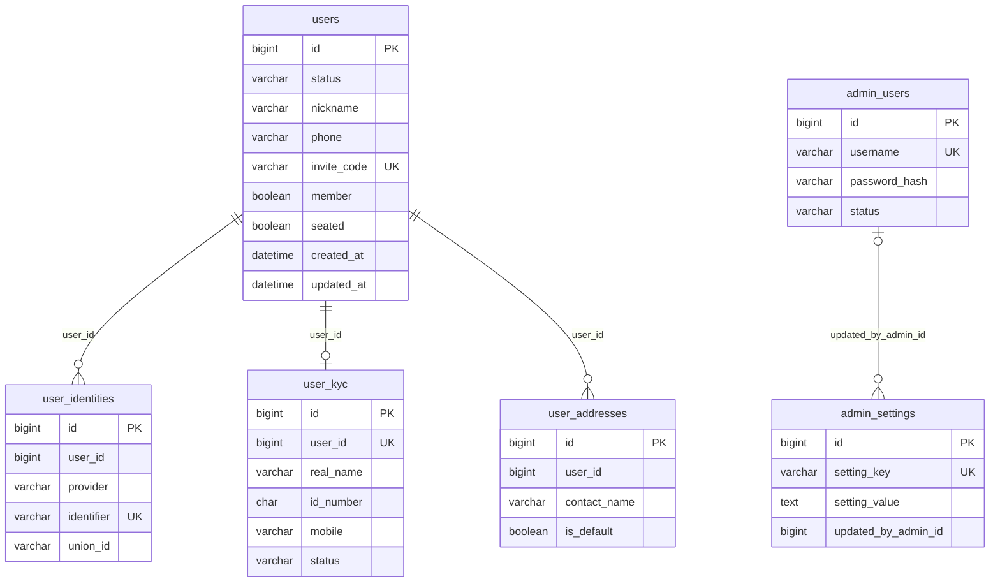
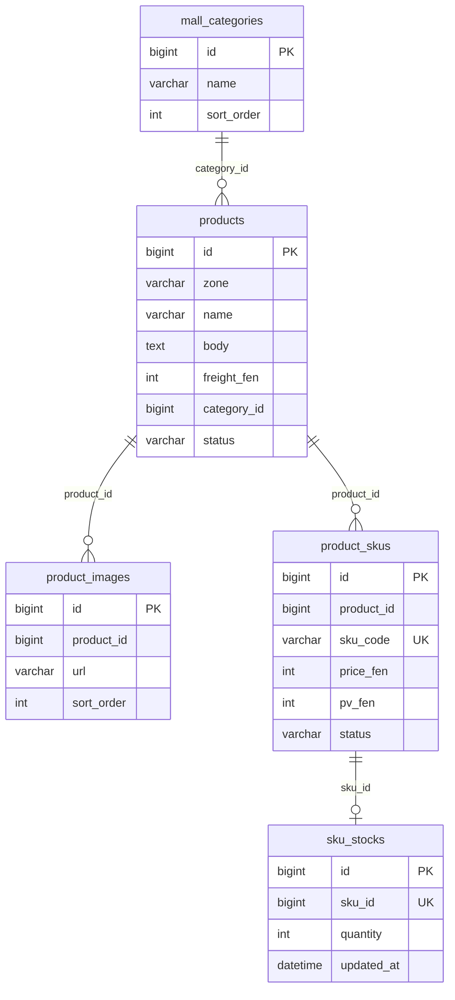
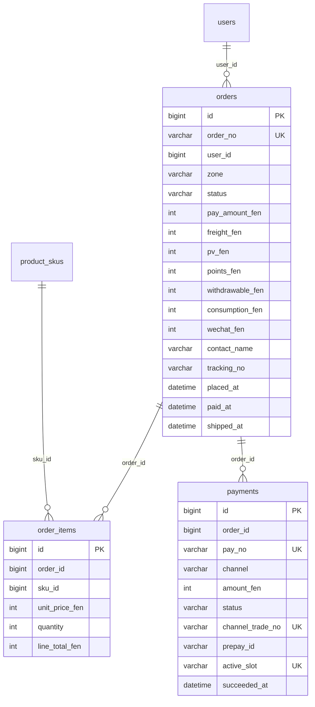
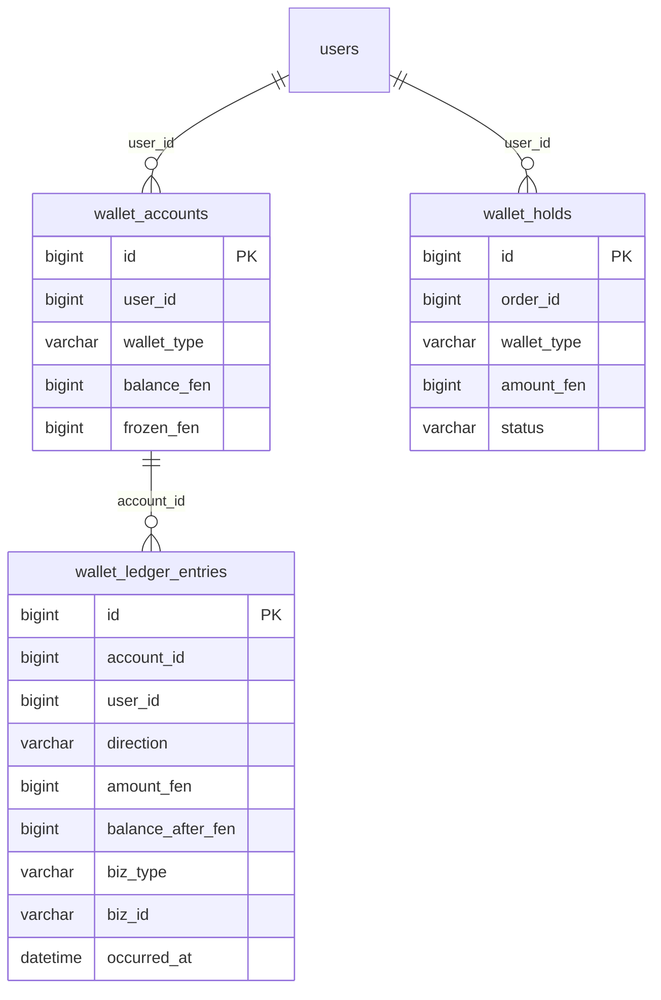
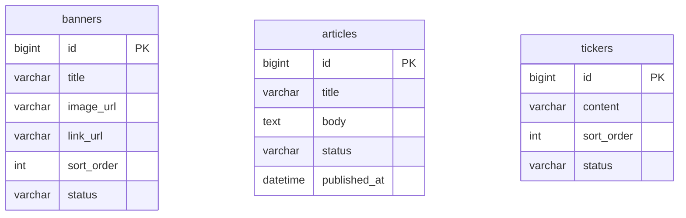
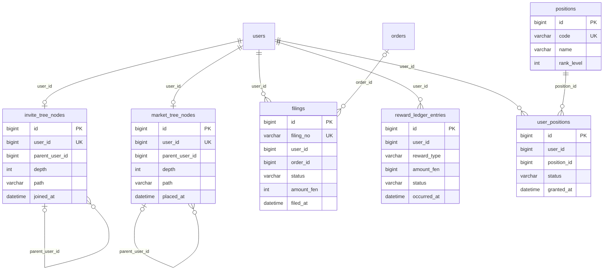
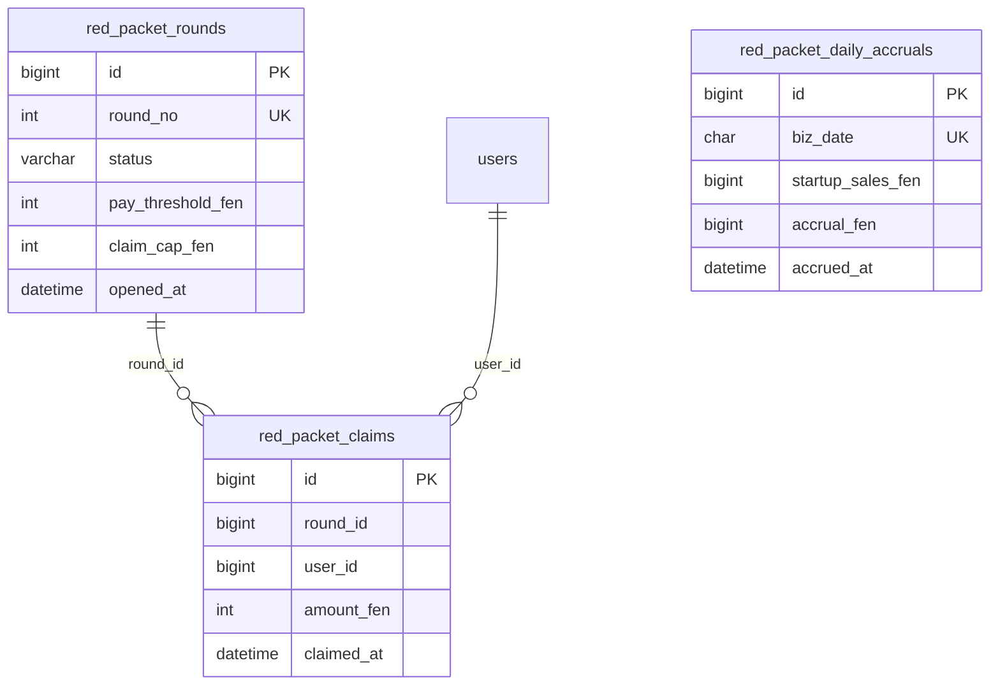

# 数据模型（逻辑关系）

图中的连线是**逻辑关联**和基数，不是数据库外键。表之间只保存对方的 id，并建立普通索引或唯一索引。完整性以后由服务层保证，Prisma 模型里没有 `@relation`。

金额字段单位是**分**。业务时间由应用通过 `ClockService` 写入，列上没有 `CURRENT_TIMESTAMP` 默认值。

小程序登录键是 `user_identities` 里 `provider = wechat_mini` 的 openid。手机号不是登录键。`wechat_oa`、`wechat_web`、`sms_phone` 只预留。`union_id` 只留存，不参与合并。

渲染好的图：

| 域                   | Mermaid 源                                    | SVG                           | PNG                           |
| -------------------- | --------------------------------------------- | ----------------------------- | ----------------------------- |
| 身份、地址、管理员   | [01-identity.mmd](er/01-identity.mmd)         | [SVG](er/01-identity.svg)     | [PNG](er/01-identity.png)     |
| 商品、SKU、库存      | [02-catalog.mmd](er/02-catalog.mmd)           | [SVG](er/02-catalog.svg)      | [PNG](er/02-catalog.png)      |
| 订单与支付           | [03-orders.mmd](er/03-orders.mmd)             | [SVG](er/03-orders.svg)       | [PNG](er/03-orders.png)       |
| 钱包流水             | [04-wallet.mmd](er/04-wallet.mmd)             | [SVG](er/04-wallet.svg)       | [PNG](er/04-wallet.png)       |
| 内容                 | [05-cms.mmd](er/05-cms.mmd)                   | [SVG](er/05-cms.svg)          | [PNG](er/05-cms.png)          |
| 树、报单、奖励、职位 | [06-organization.mmd](er/06-organization.mmd) | [SVG](er/06-organization.svg) | [PNG](er/06-organization.png) |
| 红包                 | [07-red-packet.mmd](er/07-red-packet.mmd)     | [SVG](er/07-red-packet.svg)   | [PNG](er/07-red-packet.png)   |

## 1. 身份、地址、管理员

`admin_settings` 只放管理员可改的配置（营销经理市场门槛 T，以及微信支付商户号、API 证书、APIv3 密钥）。锁定配置不进这张表。证书放在 `TEXT` 字段里。

`users.phone` 是微信手机号组件绑定的号码，可空、不唯一。`users.invite_code` 根账户是 `ROOT`。其他用户在第一次入座前为空，入座时写入唯一邀请码。`users.member` 和 `users.seated` 表示已经有市场席位，入座时一起写成 true。`user_kyc` 保存姓名、身份证号和手机号；格式通过后 `status = verified`。

## 2. 商品、SKU、库存

`products.zone` 是 `mall`（会员商城）或 `startup`（创业专区）。每个商品一个 SKU。价格和运费是分。商城 `pv_fen` 也是分，100 = 1 PV = 1 元；创业专区保持 null。`mall_categories` 只给会员商城用。

## 3. 订单与支付

`payments.channel = wechat` 时走微信支付下单和回调。状态是 `pending` / `success` / `failed`。金额是订单拆分后的 `wechat_fen`，不是整个应付。`placed_at` / `paid_at` / `shipped_at` / `succeeded_at` 都由时钟写入。积分、可提现、消费的占用和扣款记在订单列和钱包表上。

## 4. 钱包流水

账户类型是 `points`（积分）、`withdrawable`（可提现）和 `consumption`（消费）。同一用户每种类型一行。`frozen_fen` 是待微信支付确认的占用。`wallet_holds.status` 是 `held` / `captured` / `released`。

## 5. 内容

Banner、文章、滚动条彼此没有关联。

## 6. 邀请树、市场树、报单、奖励、职位

两棵树分开存。启动时只为官方根账户各写一行：`parent_user_id` 为空，`depth` 为 0。其他用户注册后只进邀请树；创业专区支付成功后，从邀请人的席位按每层最多 3 个下级入座。有市场席位才是会员，并写回 `users.member` / `users.seated`。职位分红**份额**不在 `positions` 表里，而在环境变量 `POSITION_DIVIDEND_SHARE_TIERS`，用 `positions.code` 做逻辑对应。

## 7. 红包

日计提按 Asia/Shanghai 的日历日一行。开轮时把当时的门槛 K、单轮上限 C 抄进 `red_packet_rounds`。是否每人每轮只能领一次还没定，所以 `round_id + user_id` 只建了普通索引。

